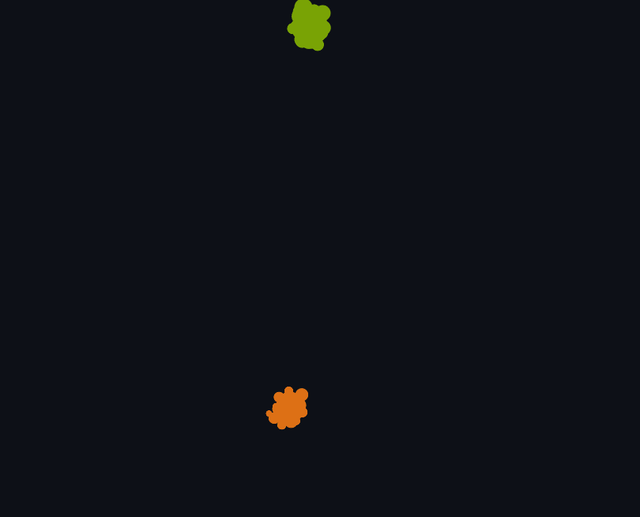

# GitHub Galaxy

Type a GitHub username and see their network as a 3D galaxy. The app follows who they
follow and who follows them, two or three hops out. It groups developers who work together
using spectral clustering on the graph Laplacian, then draws everyone as stars you can
rotate, zoom and drag.

[Tiếng Việt](README.vi.md)




## What you can do

- **Build a galaxy** for any user: depth 1-3, up to 3,000 people, with live progress.
- **Find your cluster.** Each cluster is named after the languages and topics that set it
  apart ("Vue, nuxt", "Objective-C, Swift"). The side box says where the user landed.
- **Explore.** Click a star to fly to that person and see their repos. Small dots run along
  their links in the follow direction. Click a cluster to isolate it. Drag stars around.
- **Change the grouping** without fetching anything again: pick the number of clusters, or
  switch between "follows only" and "follows + shared repos".
- **See the math.** A chart shows the smallest Laplacian eigenvalues and the gap that
  picked the number of clusters.
- **Share it.** The URL holds the settings and results are cached, so a shared link opens
  right away. Export the galaxy as JSON or PNG.

## Quick start

You need Python 3.11+ with [uv](https://docs.astral.sh/uv/), Node 20+ and a GitHub token.
Any classic token with no scopes works, because the app only reads public data. If you are
logged in with the GitHub CLI (`gh auth login`), the app uses that token and you can skip
the `.env` step.

```bash
cp .env.example .env              # then set GITHUB_TOKEN=...

cd backend
uv sync
uv run galaxy serve               # API on http://127.0.0.1:8000

# in a second terminal
cd frontend
npm install
npm run dev                       # open http://localhost:5173
```

The page also has a few pre-built sample galaxies, so you can look around before your
first build.

**One server instead of two:** run `npm run build` in `frontend/`, then `uv run galaxy serve`
serves the app and the API together on port 8000.

**Docker:**

```bash
docker build -t github-galaxy .
docker run -p 8000:8000 -e GITHUB_TOKEN=... -v galaxy-cache:/data github-galaxy
```

**Command line only:**

```bash
uv run galaxy build torvalds --depth 2 --max 800 --out torvalds.json
```

## How it works

### 1. Crawl

Follow lists come from GitHub's REST API, which pages faster than GraphQL. Profiles and
repos come from GraphQL, 10 people per query. A build of 800 people takes about 20 seconds
to 2 minutes the first time and uses about 100-400 of your 5,000 hourly API points. After
that it comes from the cache.

| Rule | Why |
|---|---|
| Hop 1 is everyone the user follows or is followed by: mutual follows first, then following, then followers. | Close ties first. |
| Up to 150 hop-1 people get their own lists fetched. | That is how the links *between* friends are found, and those links are what make clusters. |
| A person's `following` list is always used (capped at 200). Their `followers` list is used only if it has 300 people or fewer. | Following is a choice. A famous account's followers are mostly strangers. |
| Hops 2 and 3 only admit people linked to **2 or more** people already in the galaxy. | Without this, the galaxy is a ring of one-off contacts around the real groups. |
| Accounts that follow more than 5,000 people are dropped. | Follow-for-follow accounts link to everyone and blur every group. |

### 2. Graph

Each pair of people gets one undirected, weighted edge:

- mutual follow: **1.0**, one-way follow: **0.5**
- plus, in "follows + shared repos" mode, for each repo both recently contributed to or
  own: **1 / log₂(1 + m)**, where *m* is how many people in the galaxy are in that repo.
  The repo total is capped at 2.0, and repos with more than 50 members are ignored. Small
  shared repos say more than huge ones.

### 3. Spectral clustering

The method from the video, with one tweak for sparse social graphs:

1. Build the degree-regularized normalized adjacency
   *A = D<sub>τ</sub><sup>−½</sup> W D<sub>τ</sub><sup>−½</sup>*, with *D<sub>τ</sub> = D + τI*
   and *τ* = mean degree (Qin & Rohe, 2013). Without *τ*, the many people with one or two
   links dominate the smallest eigenvectors.
2. The Laplacian *L = I − A* has eigenvalues *λ = 1 − μ*. Take its 21 smallest with
   `scipy.sparse.linalg.eigsh`.
3. **Pick k.** Look at the jumps *λ<sub>k</sub> − λ<sub>k−1</sub>*. Real follow graphs rarely
   show one clean gap, so the three biggest jumps are candidates, and the one whose
   clustering has the best Newman modularity wins. You can also set *k* yourself.
4. Take each person's row of the first *k* eigenvectors, normalize it to length 1
   (Ng, Jordan & Weiss) and run k-means (10 restarts, fixed seed).

Everything uses fixed seeds, so the same input always gives the same galaxy.

### 4. Layout

Positions are computed on the server and sent with the data, so the view is stable and
needs no physics in the browser:

- **Cluster centers:** a 3D spring layout of the cluster-level graph. Clusters with more
  links between them sit closer. Then overlapping clusters are pushed apart.
- **Inside a cluster:** a 3D spring layout of its members. The cluster radius grows with
  the cube root of its size.
- The searched user's cluster sits at the center.

### 5. Rendering

Plain three.js. All stars are one `Points` draw call and all links are one `LineSegments`,
so 3,000 stars and 20,000 links stay smooth. Every animation has a job:

| When | What moves | Why |
|---|---|---|
| A galaxy loads | Stars spread out from their cluster centers while the camera pulls back | Shows the groups forming |
| You select a person or cluster | The camera flies there and everything else fades | You keep your place |
| A person is selected | Dots run along their links, follower to followee | Shows who follows whom |
| You change the grouping | Stars glide to new places and their colors cross-fade | Shows who moved |
| Nothing happens for 5 seconds | Slow rotation, which stops as soon as you touch it | Makes the 3D shape readable |

If your system asks for reduced motion, all of these are turned off.

The theme is Ayu Dark Bordered. Cluster colors are ayu's six hues, stepped and ordered
with a color-blindness check. A cluster's number and name always appear next to its color.

## API

| Method | Path | Returns |
|---|---|---|
| GET | `/api/health` | `{ok, token, rate: {remaining, resetAt}}` |
| GET | `/api/galaxy/stream?u=&d=2&n=800&s=collab` | Server-sent events: `progress {stage, done, total, msg}`, then `result {galaxy}` or `error {code, msg, reset_at}` |
| POST | `/api/recluster` `{key, k, s}` | The galaxy re-clustered from the cached crawl, without GitHub calls |

Error codes: `BAD_INPUT`, `NOT_FOUND`, `ORG_NOT_SUPPORTED`, `RATE_LIMITED`, `NO_TOKEN`,
`UPSTREAM`. The galaxy JSON format is defined in
[`frontend/src/types.ts`](frontend/src/types.ts).

## Limits

- Links are only known where someone's list was fetched. Two people at the outer hop who
  follow each other show no link unless someone in between connects them.
- "Shared repos" uses GitHub's *recent* contributions, and only for people whose lists were
  fetched. Lookups that GitHub is too slow to answer are skipped.
- Organizations can't be the center of a galaxy. People who belong to them can.
- GitHub data is cached for 24 hours and finished galaxies for 7 days.
- Only public data is requested (`privacy: PUBLIC`), so a token with more scopes doesn't
  leak private repos into a galaxy.

## Development

```bash
cd backend
uv run pytest           # 59 tests: math on planted-group graphs, crawl rules, API, client
uv run ruff check galaxy tests

cd frontend
npm run lint
npm run typecheck
npm test                # unit tests
npm run e2e             # Playwright smoke tests against the static demo build
```

To refresh the bundled samples (needs a token):

```bash
cd backend
uv run galaxy samples gaearon sindresorhus mitsuhiko antfu
```

```
backend/galaxy/
  github.py     REST + GraphQL client, batching, retries, per-user cache
  crawl.py      the crawl rules above
  graph.py      weighted sparse adjacency
  spectral.py   Laplacian, eigengap, k-means, modularity
  layout.py     3D positions
  labels.py     cluster names and colors
  api.py        FastAPI + server-sent events
frontend/src/
  galaxy/scene.ts     three.js renderer, picking, camera, animations
  galaxy/animate.ts   small tween helper
  components/         the boxes around the canvas
```

**Static demo:** `npm run build:demo` builds a version that only shows the sample
galaxies and needs no server. The `Demo` workflow publishes it to GitHub Pages once Pages
is set to "GitHub Actions" in the repo settings.

## License

MIT
