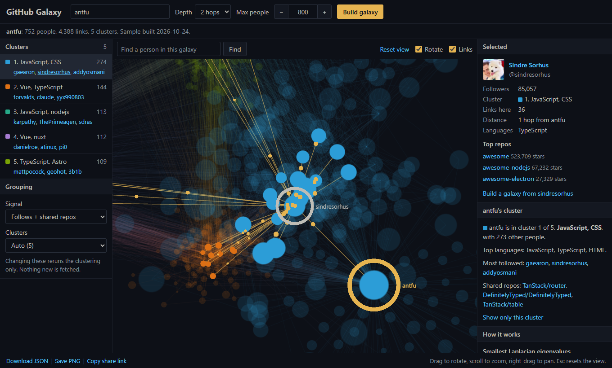

# GitHub Galaxy

Nhập một username GitHub và xem mạng lưới của người đó dưới dạng một thiên hà 3D. Ứng dụng
lấy danh sách người họ follow và người follow họ, mở rộng ra bậc 2 hoặc bậc 3. Sau đó nó gom
những developer hay làm việc chung bằng spectral clustering trên ma trận Laplace, rồi vẽ mỗi
người thành một ngôi sao để bạn xoay, zoom và kéo thả.

**[Bản demo](https://kkdoestech.github.io/github-galaxy/)** (các thiên hà mẫu; chạy trên máy
để tạo cho bất kỳ ai) · [English](README.md)



## Chạy thử

Cần Python 3.11+ với [uv](https://docs.astral.sh/uv/), Node 20+ và một GitHub token. Token
nào cũng được, không cần quyền gì, vì ứng dụng chỉ đọc dữ liệu công khai. Nếu bạn đã đăng
nhập GitHub CLI (`gh auth login`), ứng dụng tự dùng token đó và bạn có thể bỏ qua file `.env`.

```bash
cp .env.example .env              # rồi điền GITHUB_TOKEN=...

cd backend
uv sync
uv run galaxy serve               # API ở http://127.0.0.1:8000

# mở terminal thứ hai
cd frontend
npm install
npm run dev                       # mở http://localhost:5173
```

Trang có sẵn vài thiên hà mẫu để xem trước khi tự tạo.

## Cách hoạt động

1. **Thu thập.** Danh sách follow lấy qua REST API, hồ sơ và repo lấy qua GraphQL. Ở bậc 2
   và 3, chỉ giữ người có liên kết với ít nhất 2 người đã có trong thiên hà. Tài khoản
   follow hơn 5.000 người bị loại vì họ nối với tất cả mọi người.
2. **Đồ thị.** Follow hai chiều nặng 1.0, follow một chiều 0.5. Ở chế độ "follow + repo
   chung", mỗi repo hai người cùng đóng góp cộng thêm 1/log₂(1 + số người trong repo).
3. **Spectral clustering.** Dựng ma trận Laplace chuẩn hóa *L = I − D<sup>−½</sup>WD<sup>−½</sup>*
   (có điều chỉnh bậc cho đồ thị thưa), lấy các trị riêng nhỏ nhất và chọn *k* theo khoảng
   nhảy lớn (eigengap) kết hợp modularity. Mỗi người là một hàng của *k* vector riêng đầu,
   rồi chạy k-means.
4. **Bố cục.** Server tính sẵn vị trí 3D: các cụm liên kết nhiều thì nằm gần nhau, sao
   trong mỗi cụm được xếp bằng spring layout.
5. **Hiển thị.** three.js với giao diện Ayu Dark Bordered. Mỗi hiệu ứng động đều có lý do:
   sao tỏa ra khi tải xong, camera bay đến người hoặc cụm bạn chọn, chấm sáng chạy theo
   hướng follow, sao trượt sang vị trí mới khi đổi số cụm.

Chi tiết đầy đủ, API và giới hạn có trong [README tiếng Anh](README.md).

## Giấy phép

MIT
